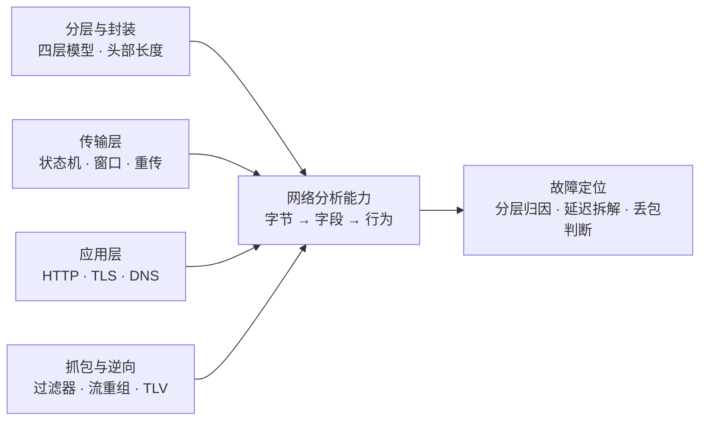

# 学习路线：12 周

> 一句话：用 12 周把「能上网」变成「能解释每一个字节、能定位每一秒延迟」。

## 这份路线怎么用

- 12 周 = **6 个阶段，每阶段 2 周**，每个阶段对应 2 篇 `docs/`，最后落到一个能跑的实验或一份能拿出来的分析。
- 不要求「看完」，要求**合上文档能讲出来**。每篇末尾的 3 条自测就是验收标准。
- 每阶段的产出都要能指回证据：字节、命令输出、包序号、过滤器。没有证据的结论不算结论。

## 能力模型

四块地基，缺一块都会在排障时卡住：

| 模块 | 必须掌握 | 为什么分析需要 |
|:---:|---|---|
| 分层与封装 | TCP/IP 四层、每层头部长什么样、封装与解封装 | 出问题先判断故障在哪一层 |
| 传输层 | TCP 状态机、序列号/ACK、滑动窗口、拥塞控制、UDP 语义 | 大部分「时快时慢」在这里能解释 |
| 应用层 | HTTP/1.1、HTTP/2、HTTP/3、TLS 1.3、DNS | 性能分析与抓包的主战场 |
| 抓包与逆向 | Wireshark 过滤器、跟随 TCP 流、自定义二进制协议 | 没有抓包就没有证据 |

推荐顺序：**分层与封装 → 以太网/ARP/IPv4 → TCP 建连与可靠传输 → HTTP/TLS → HTTP/2、HTTP/3 → 抓包与自定义协议 → 综合排障**。

### 不同起点的读法

| 你的现状 | 建议路线 | 说明 |
|:---:|---|---|
| 完全没接触过抓包 | 从阶段 1 顺序读，先把 lab 跑通 | 先把「字节 → 字段」的手感建立起来 |
| 会写代码但不熟网络 | 阶段 1、2 快速过，重点做阶段 3、4 的验证 | 封装与状态机是后面所有内容的底座 |
| 平时只做业务排障 | 直接读 [10 · 延迟分解](10-latency-and-troubleshooting.md)，再回头补 01–06 | 先用五段法解决眼前问题，再补原理 |
| 想做协议逆向 | 阶段 1、2 打底后跳到 [08](08-capture-and-analysis.md)、[09](09-custom-binary-protocol.md) | 定界与端序是逆向的分水岭 |

---

## 阶段 1（第 1–2 周）：分层模型与数据封装

- 四层模型与 PDU、封装/解封装方向
- 一次 HTTP 请求在每一层各加了什么头、总长多少
- 以太网帧格式、EtherType、ARP 的请求与应答
- IPv4 头逐字段、CIDR 与子网划分、分片与 MTU

**对应文档**：[01 · 分层与封装](01-layers-and-encapsulation.md)、[02 · 以太网 / ARP / IPv4](02-ethernet-arp-ip.md)

**产出**：[`labs/01-packet-craft`](../labs/01-packet-craft/) —— 用纯标准库手工拼 IPv4/TCP/UDP/DNS 字节，并解析回字段。

**阶段验收**：能说出 `1500 - 20 - 20 = 1460` 里每个数字是什么；能画出一次 HTTP 请求的封装顺序；能解释同一网段和跨网段时 ARP 问的是谁。

## 阶段 2（第 3–4 周）：TCP 建连与可靠传输

- 三次握手、ISN、状态机、四次挥手、TIME_WAIT
- 序列号与累计 ACK、SACK
- RTT 测量与 RTO、滑动窗口、慢启动、拥塞避免、快重传
- 零窗口、Nagle 与延迟 ACK

**对应文档**：[03 · TCP 三次握手](03-tcp-handshake.md)、[04 · TCP 可靠传输](04-tcp-reliability.md)

**产出**：用 `netstat -ano` 记录一个连接从 `LISTEN` 到 `ESTABLISHED` 再到 `CLOSE_WAIT` / `TIME_WAIT` 的完整状态，写进 `notes/`。

**阶段验收**：能解释 SYN 为什么占用一个序列号；能说出 TIME_WAIT 存在的两个理由；看到「重传」能先问「是丢包、乱序，还是窗口为零」。

## 阶段 3（第 5–6 周）：UDP 与应用层协议

- UDP 报文格式、校验和、无连接语义与适用场景
- DNS 报文结构、递归/迭代、缓存与 TTL、EDNS0
- HTTP/1.1 报文、连接复用、缓存头
- TLS 1.3 握手、证书链、SNI 与 ALPN

**对应文档**：[05 · UDP 与 DNS](05-udp-and-dns.md)、[06 · HTTP 与 TLS](06-http-and-tls.md)

**产出**：用手工构造的 DNS 查询字节对上一次真实解析（见 lab 输出），再用 `Resolve-DnsName` 验证 TTL 递减。

**阶段验收**：能说出 DNS 在什么情况下走 TCP；能说出 TLS 1.3 的 1-RTT 到底省掉了哪一次往返；能解释证书链里每一环的作用。

## 阶段 4（第 7–8 周）：HTTP/2 与 HTTP/3

- HTTP/2 二进制分帧、多路复用、HPACK、流控
- TCP 层队头阻塞为什么仍在
- QUIC 握手、连接 ID、0-RTT 与重放风险
- HTTP/3 的分层结构与 QPACK

**对应文档**：[07 · HTTP/2 与 HTTP/3](07-http2-http3-quic.md)

**产出**：用 Python `ssl` 模块做一次 ALPN 探测，记录服务器选中的协议；在 `notes/` 里对比 HTTP/1.1、HTTP/2、HTTP/3 的差异。

**阶段验收**：能说清「HTTP/2 解决了应用层队头阻塞，但没解决传输层」；能解释 QUIC 为什么在 UDP 之上自己实现可靠传输。

## 阶段 5（第 9–10 周）：抓包与自定义协议

- Wireshark 显示过滤器、tcpdump、跟随 TCP 流、`tshark` 字段提取
- 从抓包定位问题：重传、零窗口、RST、DNS 失败
- 自定义二进制协议：魔数、长度字段、TLV、端序
- 粘包与半包、CRC/校验和识别、压缩与加密初判

**对应文档**：[08 · 抓包与协议分析](08-capture-and-analysis.md)、[09 · 自定义二进制协议](09-custom-binary-protocol.md)

**产出**：对一个自己可控的服务抓一段流量，写出「分组边界 + 字段表」；补全 [`notes/_TEMPLATE.md`](../notes/_TEMPLATE.md) 里的一条完整记录。

**阶段验收**：给出一个从没见过的 TCP 负载，能判断它是定长、分隔符还是长度字段定界，并还原出至少 3 个字段。

## 阶段 6（第 11–12 周）：延迟分解与故障排查（综合）

- 延迟分解：DNS / TCP / TLS / TTFB / 传输
- MTU 与 PMTUD、黑洞、MSS 协商
- 丢包、乱序、零窗口的区分
- 用一条决策树把前面所有知识串起来

**对应文档**：[10 · 延迟分解与故障排查](10-latency-and-troubleshooting.md)

**产出**：一次真实的延迟拆解报告（`curl -w` 数据 + 抓包证据 + 结论），存进 `notes/`。

**阶段验收**：拿到「线上卡顿」，能只靠抓包把延迟拆到具体一段，并给出下一步验证动作。

---

## 阶段产出总表

| 阶段 | 周次 | 对应文档 | 产出 | 验收问题 |
|:---:|:---:|---|---|---|
| 1 | 1–2 | [01](01-layers-and-encapsulation.md) / [02](02-ethernet-arp-ip.md) | [`labs/01-packet-craft`](../labs/01-packet-craft/) | 一帧 HTTPS 请求共多少字节？ARP 跨网段问谁？ |
| 2 | 3–4 | [03](03-tcp-handshake.md) / [04](04-tcp-reliability.md) | 一次连接状态迁移记录 | SYN 为什么占序列号？TIME_WAIT 为什么存在？ |
| 3 | 5–6 | [05](05-udp-and-dns.md) / [06](06-http-and-tls.md) | 一次 HTTPS 请求的字段拆解 | DNS 何时走 TCP？TLS 1.3 省了哪次往返？ |
| 4 | 7–8 | [07](07-http2-http3-quic.md) | 三代协议对比表 + ALPN 探测 | h2 的队头阻塞在哪一层？QUIC 为什么用连接 ID？ |
| 5 | 9–10 | [08](08-capture-and-analysis.md) / [09](09-custom-binary-protocol.md) | 一份自定义协议的字段表 | 怎么定界？长度字段是哪种口径？ |
| 6 | 11–12 | [10](10-latency-and-troubleshooting.md) | 一份延迟拆解报告 | 五段各占多少？瓶颈证据是什么？ |

## 常见失败模式

| 失败模式 | 表现 | 纠正方式 |
|:---:|---|---|
| **只看 total** | 说「接口慢了 1 秒」，但说不出哪一段 | 用 `curl -w` 拆成五段，先归因再优化 |
| **背协议不验证** | 能背字段表，但看到十六进制读不出来 | 每篇至少跑一次验证命令，用 lab 对照字节 |
| **抓到包就下结论** | 看到重传就断定丢包 | 先排零窗口、再看 dup ACK/SACK、最后看 RTO |
| **只收藏不实践** | 工具装了一堆，lab 一个没跑 | 以 TASKS.md 的复选框为准，勾掉才算学完 |

---

## 每周节奏

| 时间 | 做什么 | 要求 |
|:---:|---|---|
| 周中 2 晚 | 读本阶段 2 篇文档，跑完里面的验证命令 | 每篇至少产出一条 `notes/` 记录 |
| 周末半天 | 做本阶段实验 / 分析 | 产出必须可复现（命令 + 输出 + 结论） |
| 周末 30 分钟 | 复盘：回答自测题 | 讲不出来就回去补对应小节 |

## 检验标准

学完不等于会了。用这三个问题自检：

1. 给你一次线上卡顿，你能只靠抓包把延迟拆到 DNS / TCP / TLS / TTFB / 传输 的哪一段吗？
2. 给你一段未知的 TCP 负载字节，你能判断它的序列化边界（长度字段 / TLV / 定长）并还原出字段语义吗？
3. 给你一个「偶发重传」的抓包，你能说出是丢包、乱序、还是接收窗口为零造成的吗？

三个都能答上来，才算真的入门。

## 环境

本仓库的验证全部在一台 Windows 11 x64 机器上完成。已确认可用：

| 工具 | 版本 / 说明 | 用途 |
|:---:|---|---|
| Windows 11 x64 | 主力平台 | 命令、`netsh`、`netstat` |
| Python 3.11 | 用 `py` 启动，**不是** `python` | lab 与所有字节级验证 |
| MinGW-w64 gcc 14.2 | `gcc --version` 可查 | 需要时写小工具验证 |
| curl 8.22.0 | Schannel 后端，**不含 HTTP/2、HTTP/3 支持** | HTTP 层验证、`-w` 计时 |
| WPA / xperf / wpr | Windows Performance Toolkit 10.0.26100 | 系统级 ETW trace（ETL）分析 |

尚未安装、文档里会明确标注「需先安装」：

| 工具 | 现状 | 安装途径 |
|:---:|---|---|
| Wireshark / tshark / dumpcap | 未安装 | 官网 <https://www.wireshark.org/download.html>，安装时勾选 Npcap |
| nmap / ncat | 未安装 | 官网 <https://nmap.org/download.html>（仅用于授权范围内的连通性检查） |
| openssl / dig | 未安装 | 用 Python `ssl`、`socket` 替代 |

> **注意本机的 Python 坑**：`python` 是 Microsoft Store 的占位 stub，直接运行会失败且没有任何输出（`EXIT=9009`）。本仓库所有命令统一写 `py`。另外，`py craft.py` 这种写法要求脚本首行不能是 `#!/usr/bin/env python3`，否则 `py` 启动器会去找不存在的 `python3`，同样得到 9009 —— lab 的 `craft.py` 已经去掉了 shebang。

## 相关入口

- 实验索引：[`labs/README.md`](../labs/README.md)
- 记录模板：[`notes/_TEMPLATE.md`](../notes/_TEMPLATE.md)
- 资源与授权边界：[`resources.md`](../resources.md)
- 任务清单：[`TASKS.md`](../TASKS.md)
